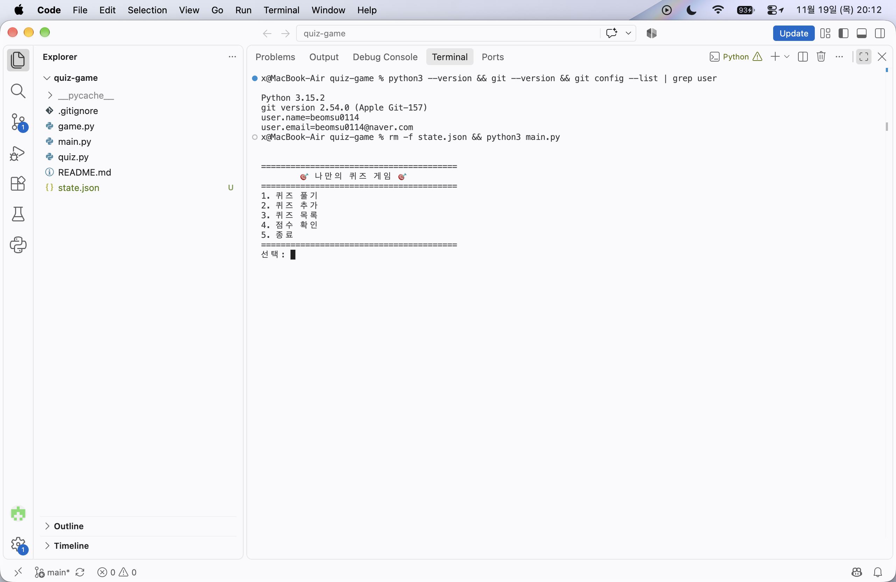

# 🎯 나만의 퀴즈 게임 (quiz-game)

## 1. 프로젝트 개요
Python 기본 문법과 객체 지향 프로그래밍(OOP)을 활용해 만든 터미널 기반 퀴즈 게임입니다. `state.json` 파일을 통해 프로그램 종료 후에도 추가된 퀴즈와 최고 점수가 유지됩니다.

## 2. 퀴즈 주제 및 선정 이유
- **주제**: IT 및 프로그래밍 기초 상식
- **선정 이유**: Python과 Git을 학습하며 배운 핵심 개념들을 퀴즈로 복습하기 위해 선정했습니다.

## 3. 실행 방법
```bash
python3 main.py
```

## 4. 기능 목록
- **퀴즈 풀기**: 등록된 문제를 순서대로 풀고 점수 확인
- **퀴즈 추가**: 새 문제, 4개의 선택지, 정답을 입력해 등록
- **퀴즈 목록**: 저장된 전체 퀴즈 목록 조회
- **점수 확인**: 역대 최고 점수 조회
- **예외 처리**: 잘못된 입력(문자, 공백, 범위 초과) 재입력 및 `Ctrl+C` 안전 종료

## 5. 파일 구조
```text
quiz-game/
├── main.py      # 실행 진입점 및 전역 종료 예외 처리
├── quiz.py      # Quiz 클래스 및 기본 퀴즈 5문제 데이터
├── game.py      # QuizGame 클래스 (메뉴, 게임 진행, 입력 검증, 파일 입출력)
├── state.json   # 퀴즈 목록 및 최고 점수 저장 파일 (UTF-8)
├── .gitignore   # Git 추적 제외 설정
└── README.md    # 프로젝트 설명 문서
```

## 6. 데이터 파일 설명 (`state.json`)
- **경로**: 프로젝트 루트 디렉터리 (`./state.json`)
- **역할**: 프로그램 종료 후에도 퀴즈 목록과 최고 점수를 영구 보관하는 UTF-8 JSON 파일입니다.
- **스키마**:
```json
{
    "quizzes": [
        {
            "question": "문제 내용",
            "choices": ["선택지1", "선택지2", "선택지3", "선택지4"],
            "answer": 1
        }
    ],
    "best_score": 100
}
```

## 7. 실행 및 Git 로그 스크린샷

### 개발 환경 설정


### 퀴즈 추가 및 목록 조회


### 퀴즈 풀기 및 최고 점수 확인


### 프로그램 재실행 및 데이터 영속성 확인


### Git 커밋 히스토리 및 브랜치 그래프

