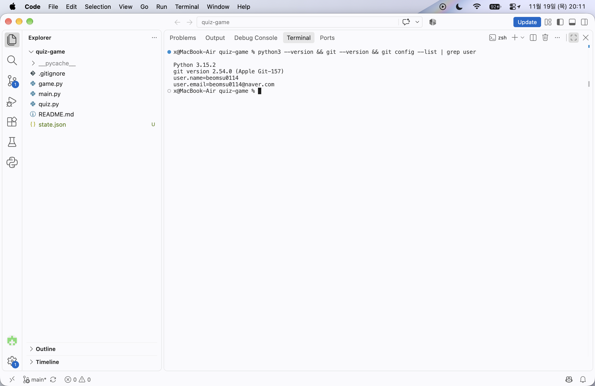
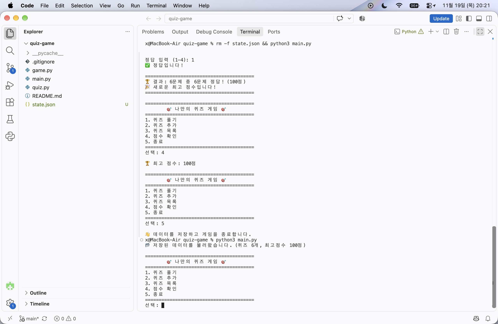
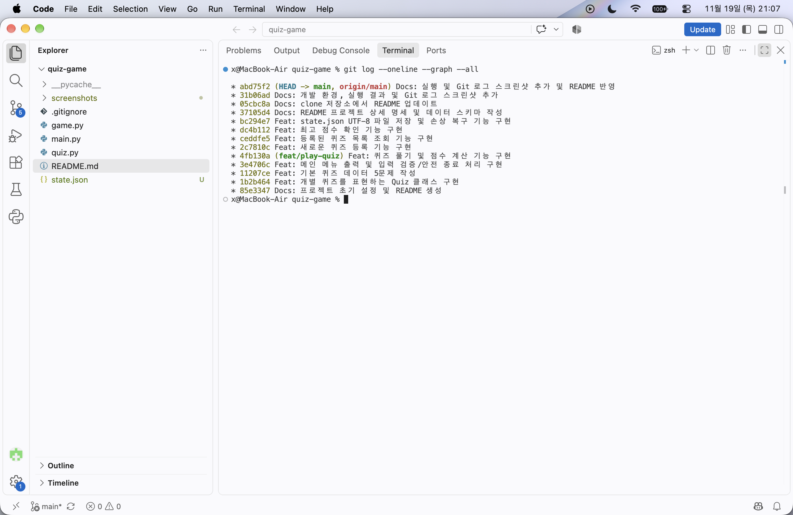

# 🎯 나만의 퀴즈 게임 (quiz-game)

## 1. 프로젝트 개요
Python 기본 문법과 객체 지향 프로그래밍(OOP)을 활용해 만든 터미널 기반 퀴즈 게임입니다. `state.json` 파일을 통해 프로그램 종료 후에도 추가된 퀴즈와 최고 점수가 유지됩니다.

## 2. 퀴즈 주제 및 선정 이유
- **주제**: IT 및 프로그래밍 기초 상식
- **선정 이유**: Python과 Git을 학습하며 배운 핵심 개념들을 퀴즈로 복습하기 위해 선정했습니다.

## 3. 실행 방법
```bash
python3 main.py
```

## 4. 기능 목록
- **퀴즈 풀기**: 등록된 문제를 순서대로 풀고 점수 확인
- **퀴즈 추가**: 새 문제, 4개의 선택지, 정답을 입력해 등록
- **퀴즈 목록**: 저장된 전체 퀴즈 목록 조회
- **점수 확인**: 역대 최고 점수 조회
- **예외 처리**: 잘못된 입력(문자, 공백, 범위 초과) 재입력 및 `Ctrl+C` 안전 종료

## 5. 파일 구조
```text
quiz-game/
├── main.py      # 실행 진입점 및 전역 종료 예외 처리
├── quiz.py      # Quiz 클래스 및 기본 퀴즈 5문제 데이터
├── game.py      # QuizGame 클래스 (메뉴, 게임 진행, 입력 검증, 파일 입출력)
├── state.json   # 퀴즈 목록 및 최고 점수 저장 파일 (UTF-8)
├── .gitignore   # Git 추적 제외 설정
└── README.md    # 프로젝트 설명 문서
```

## 6. 데이터 파일 설명 (`state.json`)
- **경로**: 프로젝트 루트 디렉터리 (`./state.json`)
- **역할**: 프로그램 종료 후에도 퀴즈 목록과 최고 점수를 영구 보관하는 UTF-8 JSON 파일입니다.
- **스키마**:
```json
{
    "quizzes": [
        {
            "question": "문제 내용",
            "choices": ["선택지1", "선택지2", "선택지3", "선택지4"],
            "answer": 1
        }
    ],
    "best_score": 100
}
```

## 7. 실행 및 Git 로그 스크린샷

### 개발 환경 설정


### 퀴즈 추가 및 목록 조회


### 퀴즈 풀기 및 최고 점수 확인


### 프로그램 재실행 및 데이터 영속성 확인


### Git 커밋 히스토리 및 브랜치 그래프


## 8. 아키텍처 및 설계 의도

### 8.1 객체지향(OOP) 설계 및 클래스 선택 이유
* **클래스 기반 설계 vs 함수형 대안:** 단순 함수와 전역 딕셔너리 조합은 상태(`quizzes`, `best_score`)가 여러 함수에 흩어져 데이터 무결성 관리가 어렵습니다. `Quiz`와 `QuizGame` 클래스로 상태와 동작을 캡슐화하여 결합도를 낮추고 재사용성과 테스트 용이성을 높였습니다.
* **역할 분리 근거:**
  * `Quiz` (`quiz.py`): 개별 문제의 데이터 구조, 선택지 포맷팅, 정오답 판정 등 **도메인 모델 책임**만 담당합니다.
  * `QuizGame` (`game.py`): 게임 흐름 제어, 메뉴 인터페이스, 상태 영속화 등 **애플리케이션 제어 책임**을 담당합니다.

### 8.2 입력 검증과 데이터 입출력(I/O) 책임 분리
* **입력 검증 계층 (`get_valid_int`, `get_non_empty_str`):** 사용자 표준 입력(`input`) 단계에서 공백, 비숫자, 허용 범위 초과 값을 즉시 차단하여 비즈니스 로직으로 유효한 값만 전달합니다.
* **데이터 입출력 계층 (`load_state`, `save_state`):** 검증이 완료된 상태 객체만 JSON 직렬화하여 디스크에 기록하므로, 잘못된 사용자 입력이 저장 파일(`state.json`)을 오염시키는 것을 원천 방지합니다.

### 8.3 JSON 데이터 형식 선택 이유 및 한계
* **JSON 선택 이유:** 별도 외부 라이브러리 없이 Python 표준 `json` 모듈만으로 직렬화/역직렬화가 가능하며, 사람이 직접 열어 구조를 검증할 수 있는 높은 가독성과 이식성을 갖추고 있습니다.
* **필드별 설계 의도:**
  * `best_score` (`int`): 누적 최고 점수를 단일 정수 필드로 분리해 퀴즈 목록 순회 없이 즉시 조회 및 갱신합니다.
  * `quizzes` (`list[dict]`): 문제(`question`), 4지선다 배열(`choices`), 정답 번호(`answer`)를 순서가 보장되는 중첩 객체 배열로 구조화했습니다.
* **저장 방식의 한계 및 복구 정책:** 단일 JSON 파일 전체를 메모리에 로드·덮어쓰기하는 방식이므로 수만 건 이상의 대규모 데이터 환경에서는 메모리 점유 및 I/O 병목이 발생할 수 있습니다. 파일 손상(`JSONDecodeError`) 감지 시 기본 퀴즈 5문제로 자동 복구되며, 수동 초기화가 필요한 경우 `state.json` 삭제 후 재실행하면 초기 상태로 복원됩니다.

---

## 9. 유지보수 및 변경 영향도 매핑

| 요구사항 변경 유형 | 수정 대상 파일 | 관련 클래스 / 메서드 |
| :--- | :--- | :--- |
| 기본 퀴즈 문제 추가·수정 | `quiz.py` | `get_default_quizzes()` |
| 문제 선택지 개수 및 채점 기준 변경 | `quiz.py` / `game.py` | `Quiz.is_correct()`, `QuizGame.add_quiz()` |
| 메뉴 항목 추가 및 흐름 변경 | `game.py` | `QuizGame.print_menu()`, `QuizGame.run()` |
| 입력 검증 범위 및 예외 문구 수정 | `game.py` | `QuizGame.get_valid_int()`, `QuizGame.get_non_empty_str()` |
| 저장 파일 경로 및 JSON 스키마 변경 | `game.py` | `QuizGame.load_state()`, `QuizGame.save_state()` |
| 프로그램 강제 종료(`Ctrl+C`) 처리 | `main.py` | `main()` (`KeyboardInterrupt`, `EOFError` 핸들러) |

---

## 10. Git 협업 및 커밋·브랜치 정책

### 10.1 커밋 단위 및 메시지 규칙
* **커밋 단위:** 기능 구현, 문서화, 버그 수정 등 논리적으로 완결된 최소 작업 단위로 커밋합니다.
* **메시지 형식:** `<유형>: <변경 내용 요약>` 형식을 따릅니다.
  * `Feat`: 새로운 기능 추가 (예: `Feat: 퀴즈 풀기 및 점수 계산 기능 구현`)
  * `Docs`: README 및 스크린샷 문서 보완 (예: `Docs: README 프로젝트 상세 명세 작성`)
  * `Fix`: 오류 및 파일명·경로 수정

### 10.2 브랜치 분리 및 병합 정책
* `main` 브랜치는 항상 실행 가능한 안정 버전을 유지하며, 신규 기능(`feat/play-quiz`)은 별도 브랜치에서 독립 개발·검증한 뒤 `main`으로 병합(`--no-ff`)하여 기능 단위 이력을 명확히 보존했습니다.

### 10.3 원격 저장소 및 커밋·병합 증빙 로그
* **원격 저장소 URL:** https://github.com/beomsu0114/quiz-game
* **전체 커밋 및 브랜치 병합 히스토리 (`git log --oneline --graph --all`, 총 14개 커밋):**
```text
* 9476ed1 (HEAD -> main, origin/main) Fix: 스크린샷 파일명 정리 및 Git 로그 이미지 추가
* abd75f2 Docs: 실행 및 Git 로그 스크린샷 추가 및 README 반영
* 31b06ad Docs: 개발 환경, 실행 결과 및 Git 로그 스크린샷 추가
* 05cbc8a Docs: clone 저장소에서 README 업데이트
* 37105d4 Docs: README 프로젝트 상세 명세 및 데이터 스키마 작성
* bc294e7 Feat: state.json UTF-8 파일 저장 및 손상 복구 기능 구현
* dc4b112 Feat: 최고 점수 확인 기능 구현
* ceddfe5 Feat: 등록된 퀴즈 목록 조회 기능 구현
* 2c7810c Feat: 새로운 퀴즈 등록 기능 구현
* 4fb130a (feat/play-quiz) Feat: 퀴즈 풀기 및 점수 계산 기능 구현
* 3e4706c Feat: 메인 메뉴 출력 및 입력 검증/안전 종료 처리 구현
* 11207ce Feat: 기본 퀴즈 데이터 5문제 작성
* 1b2b464 Feat: 개별 퀴즈를 표현하는 Quiz 클래스 구현
* 85e3347 Docs: 프로젝트 초기 설정 및 README 생성
